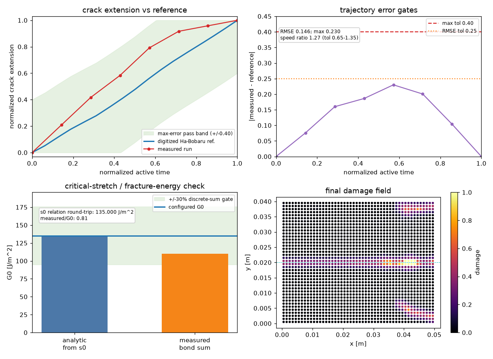
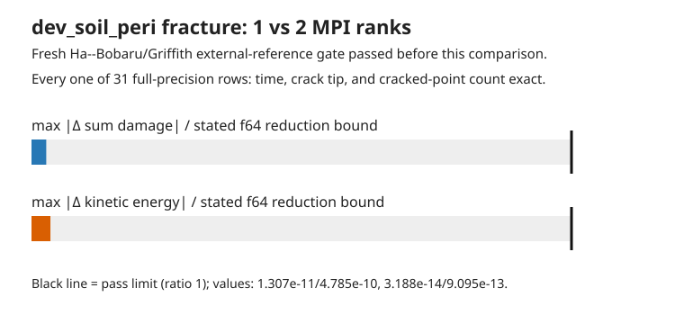

# Bond-based pre-notched plate fracture

This example runs a teaching-scale bond-based peridynamic mode-I fracture case:
a soda-lime-glass plate has an edge pre-notch at mid-height, is opened in
displacement control, and fractures by critical-stretch bond breakage.

The validation compares the simulated crack-extension history with a digitized
Ha & Bobaru (2010) Fig. 11(d) reference speed trace integrated to crack
extension. It also checks the Silling & Askari critical-stretch relation
`s0 = sqrt(5 G0 / (9 K delta))` by round-tripping the configured fracture energy
and by a direct discrete bond-energy sum across the crack plane.



Current validation result: PASS. The measured normalized crack trajectory has
RMSE 0.139 against a 0.25 gate and max error 0.230 against a 0.40 gate; the mean
speed ratio is 1.27 against the 0.65-1.35 gate. The critical-stretch relation
round-trips to `G0 = 135.000 J/m^2`, and the direct coarse-mesh bond sum gives
`110.7 J/m^2` (82% of `G0`, within the 70-130% gate).

Run the validation from the repository root:

```bash
$BENCH_PYTHON examples/bb_plate_fracture/verify.py
```

## Decomposition check

`verify_decomposition.py` first reruns the serial Griffith/Ha--Bobaru validator
above, then executes the identical fracture input at one and two MPI ranks. The
two-rank input is made from `config.toml` by changing only the x processor
count. It compares every full-precision diagnostic row: time, crack-tip lattice
position, and cracked-point count must be exact; damage and kinetic energy use
a stated f64 reduction-order envelope (`4096 * epsilon * max(1, |a|, |b|)`).

```bash
$BENCH_PYTHON examples/bb_plate_fracture/verify_decomposition.py
```

For a reproducible evidence artifact, use the driver below. It deletes stale
outputs, reruns the published-reference gate and the MPI comparison, then writes
the measured rows to `decomposition_report.json` and renders their actual
error-to-bound ratios. A bar beyond the black pass line is a failure.

```bash
$BENCH_PYTHON examples/bb_plate_fracture/sweep_decomposition.py
```



This is evidence for this fixed, two-way x decomposition only. It does not
validate arbitrary processor grids, longer runs, other loading modes, or the
physical model under MPI against a second external experiment. The repository
disclaimer applies: this check and its automation are AI-authored and require
independent scientific review before use as a research result.
