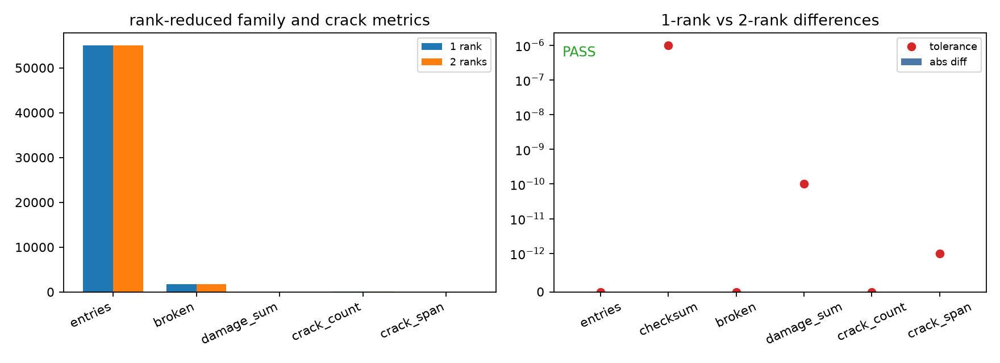

# Peridynamic Family Consistency

This validation builds the same small reference point cloud on one MPI rank and
on two ranks split across `x`. It compares the rank-reduced peridynamic family
entry count, a tag/reference-length checksum, the deterministic notch breakage
count, damage sum, damaged-point count, and crack-span metric.



Current validation result: PASS. The one-rank and two-rank runs match exactly
for family entries, broken bond endpoints, damaged-point count, and crack span;
the floating checksum and damage sum match within the stated tolerances.

Run the validation from the repository root:

```bash
$BENCH_PYTHON examples/peri_family_consistency/sweep.py
```
